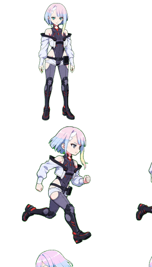
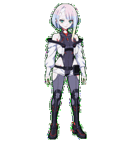

<!--
  FEX592 / FEX592 — Cyberpunk: Edgerunners profile (Lucy)
  Real artwork from Kingslie-Wong/Cyberpunk-Edgerunners-Lucy-Codex-Pet (GitHub):
  - assets/lucy-standing.png   (hero, 256×450)
  - assets/lucy-avatar.gif     (avatar, 192×208 animated)
  - assets/lucy-running.png    (banner strip, 1536×468)
  Palette: charcoal · cyberpunk yellow #FCEE0A · neon cyan #00E5FF
  Anime-profile conventions: hero image, terminal block side-by-side with character,
  devicon skill icons, modest stats widgets. No glow, no scanlines, no badges spam.
-->

  

  

<h1 align="center">FEX592</h1>

  <b>FEX</b> · Nigerian student · AI, autonomous agents, automation & software development. 
  Building useful systems from a terminal in Night City.

<table align="center">
  <tr>
    <td>
      <i>user@night-city:~$ whoami</i> 
      <b>FEX592</b> 
      <i>user@night-city:~$ cat /etc/motd</i>
      <pre>
-------------------------------------------------------------------------------
Username:      FEX592
Whoami:        AI, autonomous agents, automation & software development
OS:            Termux (Android 16)
Shell:         zsh
Location:      Night City
Languages:     TypeScript · JavaScript · HTML · CSS · Kotlin
Frontend:      React · Vite · Vercel
Backend:       Express · Node.js · Supabase
Payments:      Paystack · Brevo
-------------------------------------------------------------------------------
      </pre>
    </td>
    <td>
      
    </td>
  </tr>
</table>

  

<h3 align="center">`ACTIVE // PROJECTS`</h3>

<table align="center">
  <tr>
    <td><b>Project</b></td>
    <td><b>Stack</b></td>
    <td><b>What it is</b></td>
  </tr>
  <tr>
    <td><a href="https://github.com/FEX592/theeyas-deluxe-hub">theeyas-deluxe-hub</a></td>
    <td>React · Vite · Express · Supabase · Paystack · Brevo</td>
    <td>Storefront with Paystack payments and Brevo email.</td>
  </tr>
  <tr>
    <td><a href="https://github.com/FEX592/the-next-minds">the-next-minds</a></td>
    <td>TypeScript · Supabase · Vercel</td>
    <td>Registration & admin platform for AI for Students.</td>
  </tr>
  <tr>
    <td><a href="https://github.com/FEX592/fex-site">fex-site</a></td>
    <td>HTML · CSS · JavaScript</td>
    <td>Static portfolio site, no build step.</td>
  </tr>
  <tr>
    <td><a href="https://github.com/FEX592/Spoti-saver">Spoti-saver</a></td>
    <td>JavaScript · CLI</td>
    <td>Spotify track/playlist downloader with embedded metadata.</td>
  </tr>
</table>

  

  

<h3 align="center">`CONNECT // CONTACT`</h3>

<table align="center">
  <tr>
    <td><b>Instagram</b></td>
    <td><a href="https://instagram.com/emmanueladegbite592">emmanueladegbite592</a></td>
  </tr>
  <tr>
    <td><b>GitHub</b></td>
    <td><a href="https://github.com/FEX592">github.com/FEX592</a></td>
  </tr>
</table>

<blockquote align="center">
  Night City never sleeps. Neither does the build. 
  <i>— FEX592 // Lucy Interface // Online</i>
</blockquote>

<!--
  FEX592 is a ✨ special ✨ repository because its README.md appears on your profile.
  Artwork: real Lucy GIF/PNG from Kingslie-Wong/Cyberpunk-Edgerunners-Lucy-Codex-Pet (GitHub).
  Stats: github-readme-stats (vercel.app). Icons: skillicons.dev.
  Colors: #FCEE0A · #00E5FF. No glow, no scanlines, no badges spam.
-->
