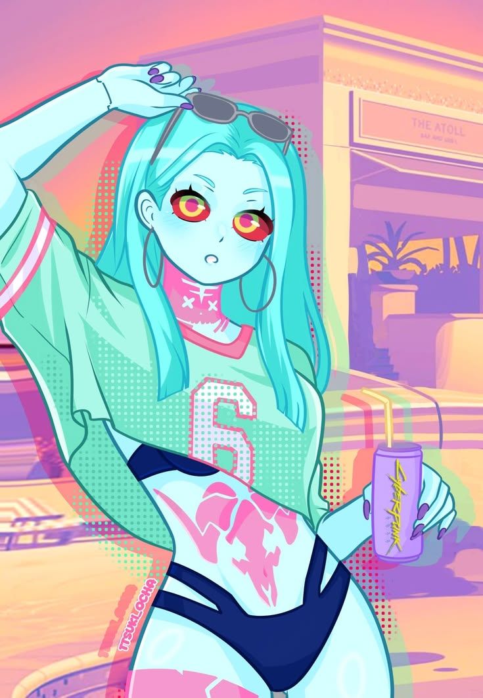

<!--
  FEX592 / FEX592 — Cyberpunk: Edgerunners profile (Lucy)
  Hero: lucy-hero.jpg ("Take Me to the Moon" — Lucy, Edgerunners)
  Avatar: lucy-cyber-art.jpeg (Lucy, Edgerunners)
  Divider: original SVG.
  Palette: charcoal #050507 · cyberpunk yellow #FCEE0A · neon cyan #00E5FF · magenta #BC13FE
  No tables, no badges, no oversized stats panels, no glow spam.
  The David & Lucy moon GIF (8.7MB) is in assets/ but not embedded — too heavy for a profile.
-->

  

  

<h1 align="center">FEX592</h1>

  <code>user@night-city:~$ whoami</code> 
  <code>FEX592</code> 
  <code>user@night-city:~$ cat /etc/motd</code>

<blockquote align="center">
  FEX · Nigerian student · AI, autonomous agents, automation & software development. 
  Building useful systems from a terminal in Night City.
</blockquote>

  

### `SYSTEM // SKILLS`

  

<code>
  Languages:  TypeScript · JavaScript · HTML · CSS · Kotlin
  Frontend:   React · Vite · Vercel
  Backend:    Express · Node.js · Supabase
  Payments:   Paystack · Brevo
  Tools:      Git · GitHub · Termux
</code>

  

### `ACTIVE // PROJECTS`

  

<code>
  [1] theeyas-deluxe-hub   React · Vite · Express · Supabase · Paystack · Brevo
        Storefront with Paystack payments and Brevo email.
        github.com/FEX592/theeyas-deluxe-hub

  [2] the-next-minds       TypeScript · Supabase · Vercel
        Registration & admin platform for AI for Students.
        github.com/FEX592/the-next-minds

  [3] fex-site             HTML · CSS · JavaScript
        Static portfolio site, no build step.
        github.com/FEX592/fex-site

  [4] Spoti-saver          JavaScript · CLI
        Spotify track/playlist downloader with embedded metadata.
        github.com/FEX592/Spoti-saver
</code>

  

### `CONNECT // CONTACT`

  

<code>
  Instagram:  emmyfex   →   instagram.com/emmyfex
  GitHub:     FEX592    →   github.com/FEX592
</code>

  

<blockquote align="center">
  Night City never sleeps. Neither does the build. 
  <i>— FEX592 // Lucy Interface // Online</i>
</blockquote>

<!--
  FEX592 is a ✨ special ✨ repository because its README.md appears on your profile.
  Artwork: lucy-hero.jpg + lucy-cyber-art.jpeg (real Lucy, from your Downloads),
  divider.svg + avatar.svg (original SVG).
  Colors: #050507 · #00E5FF · #FCEE0A · #BC13FE.
  No tables, no badges, no external image services.
-->
