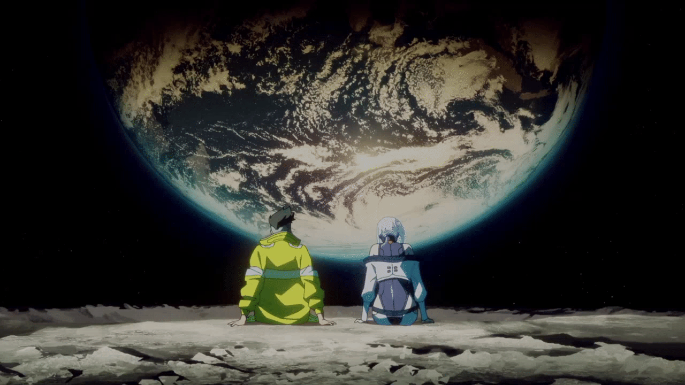

<!--
  FEX592 / FEX592 — Cyberpunk: Edgerunners profile (Lucy)
  Assets: lucy-hero.jpg (moon scene), lucy-cyber-art.jpeg (Lucy fan art),
          lucy-david-moon.gif (David & Lucy moon GIF), divider.svg (original SVG)
  Palette: charcoal #050507 · cyberpunk yellow #FCEE0A · neon cyan #00E5FF · magenta #BC13FE
  Layout: hero header, two-column table (GIF left · avatar + terminal right),
          designed tables for skills / projects / contact.
  No badges, no oversized stats panels, no external image services.
-->

  

<table align="center" width="920" border="0" cellpadding="0" cellspacing="0">
  <tr>
    <td width="360" align="center">
      
    </td>
    <td width="560" align="left">
      
      <code>user@night-city:~$ whoami</code> 
      <code>FEX592</code> 
      <code>user@night-city:~$ cat /etc/motd</code>
       
      <blockquote>
        FEX · Nigerian student · AI, autonomous agents, automation & software development. 
        Building useful systems from a terminal in Night City.
      </blockquote>
    </td>
  </tr>
</table>

  

### `SYSTEM // SKILLS`

  

<table align="center" width="600" border="1" cellpadding="10" cellspacing="0">
  <tr>
    <td width="160"><b>Languages</b></td>
    <td>TypeScript · JavaScript · HTML · CSS · Kotlin</td>
  </tr>
  <tr>
    <td><b>Frontend</b></td>
    <td>React · Vite · Vercel</td>
  </tr>
  <tr>
    <td><b>Backend</b></td>
    <td>Express · Node.js · Supabase</td>
  </tr>
  <tr>
    <td><b>Payments · Email</b></td>
    <td>Paystack · Brevo</td>
  </tr>
  <tr>
    <td><b>Tools</b></td>
    <td>Git · GitHub · Termux</td>
  </tr>
</table>

  

### `ACTIVE // PROJECTS`

  

<table align="center" width="700" border="1" cellpadding="10" cellspacing="0">
  <tr>
    <td width="180"><b>Project</b></td>
    <td width="260"><b>Stack</b></td>
    <td><b>What it is</b></td>
  </tr>
  <tr>
    <td><a href="https://github.com/FEX592/theeyas-deluxe-hub">theeyas-deluxe-hub</a></td>
    <td>React · Vite · Express · Supabase · Paystack · Brevo</td>
    <td>Storefront with Paystack payments and Brevo email.</td>
  </tr>
  <tr>
    <td><a href="https://github.com/FEX592/the-next-minds">the-next-minds</a></td>
    <td>TypeScript · Supabase · Vercel</td>
    <td>Registration & admin platform for AI for Students.</td>
  </tr>
  <tr>
    <td><a href="https://github.com/FEX592/fex-site">fex-site</a></td>
    <td>HTML · CSS · JavaScript</td>
    <td>Static portfolio site, no build step.</td>
  </tr>
  <tr>
    <td><a href="https://github.com/FEX592/Spoti-saver">Spoti-saver</a></td>
    <td>JavaScript · CLI</td>
    <td>Spotify track/playlist downloader with embedded metadata.</td>
  </tr>
</table>

  

### `CONNECT // CONTACT`

  

<table align="center" width="500" border="1" cellpadding="10" cellspacing="0">
  <tr>
    <td width="160"><b>Instagram</b></td>
    <td><a href="https://instagram.com/emmyfex">emmyfex</a> → instagram.com/emmyfex</td>
  </tr>
  <tr>
    <td><b>GitHub</b></td>
    <td><a href="https://github.com/FEX592">FEX592</a> → github.com/FEX592</td>
  </tr>
</table>

  

<blockquote align="center">
  Night City never sleeps. Neither does the build. 
  <i>— FEX592 // Lucy Interface // Online</i>
</blockquote>

<!--
  FEX592 is a ✨ special ✨ repository because its README.md appears on your profile.
  Artwork: lucy-hero.jpg + lucy-cyber-art.jpeg (real Lucy, from your Downloads),
  lucy-david-moon.gif (David & Lucy moon GIF, from your Downloads),
  divider.svg + avatar.svg (original SVG).
  Colors: #050507 · #00E5FF · #FCEE0A · #BC13FE.
  No badges, no external image services.
-->
